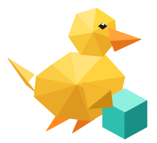
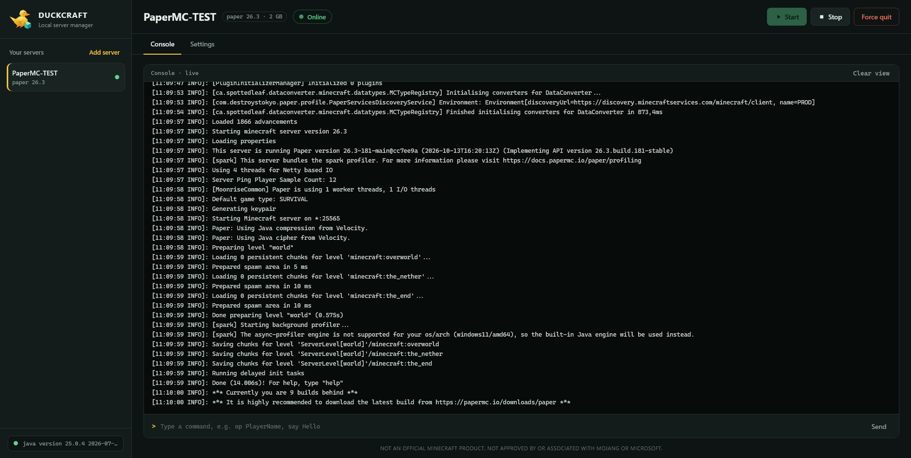

<div align="center">



# DUCKCRAFT

**A small, friendly panel for running Minecraft servers on your own computer.**
Pick an engine, pick a version, press start. No Docker, no database, no accounts.

[](LICENSE)
[](https://www.python.org/)
[](https://fastapi.tiangolo.com/)
[](https://github.com/DuckByte1337/duckcraft/stargazers)
[](https://github.com/DuckByte1337/duckcraft/commits/main)
[](#security)

[Quick start](#quick-start) · [Features](#features) · [Playing with friends](#playing-with-friends) · [Troubleshooting](#troubleshooting) · [Security](#security) · [Contributing](#contributing)

<br>



</div>

---

## Why DUCKCRAFT?

Setting up a Minecraft server usually means downloading a jar from somewhere, writing a start script, editing `eula.txt`, and hunting through `server.properties` in a text editor. DUCKCRAFT does all of that from one browser tab, while staying small enough to read in an afternoon: two source files, three dependencies.

## Features

| | |
|---|---|
| **One-click server creation** | Download **Paper** or **Vanilla** for any release straight from PaperMC and Mojang. |
| **Verified downloads** | Every jar is checked against the publisher's checksum before it is used. |
| **Live console** | Real-time log streaming with colored warnings and errors, plus a command box with history (arrow keys). |
| **Settings editor** | Edit `server.properties` with proper switches, dropdowns and number fields. Comments are preserved and a `.bak` backup is saved. |
| **Multiple servers** | Keep as many servers as you like and switch between them in the sidebar. |
| **Clear server state** | Offline, starting, online and stopping are tracked, and buttons enable themselves accordingly. |
| **Memory per server** | Choose how much RAM each server gets. |
| **Clean shutdown** | Closing the panel stops the server gracefully instead of leaving Java running in the background. |
| **Fully offline UI** | No CDNs, no web fonts, no tracking. The interface works without internet once installed. |

## Quick start

**You need**

- [Python 3.10 or newer](https://www.python.org/downloads/)
- [Java](https://adoptium.net/) matching your Minecraft version (recent versions need Java 21 or newer, see the [Minecraft Wiki](https://minecraft.wiki/w/Tutorials/Server_startup_script) for details)

**Install and run**

```bash
git clone https://github.com/DuckByte1337/duckcraft.git
cd duckcraft

python -m venv .venv
```

Activate the virtual environment:

| System | Command |
|---|---|
| Windows (PowerShell) | `.venv\Scripts\Activate.ps1` |
| Windows (cmd) | `.venv\Scripts\activate.bat` |
| macOS / Linux | `source .venv/bin/activate` |

Then install and start:

```bash
pip install -r requirements.txt
python main.py
```

Your browser opens at <http://127.0.0.1:8000>.

> **No git?** Click the green **Code** button on this page, choose **Download ZIP**, unpack it, and continue from `python -m venv .venv`.

**Your first server**

1. Click **Add server**, name it, choose **Paper** and a version, and accept the Minecraft EULA.
2. Press **Start**. The first launch generates the world and `server.properties`.
3. Press **Stop**, open the **Settings** tab, adjust anything you like, and **Save**.
4. Start again and join with `localhost` in Minecraft (Java Edition).

## Playing with friends

- **Same Wi-Fi or network:** friends join with your computer's local IP address and the server port (default `25565`).
- **Over the internet:** forward the server port on your router, or use a tunnel service such as [playit.gg](https://playit.gg) if port forwarding isn't possible (for example behind carrier-grade NAT).

playit.gg is a third-party service. DUCKCRAFT is not affiliated with it and does not bundle or install it, so read its terms first. Never post your home IP address publicly.

## Troubleshooting

<details>
<summary><b>The sidebar says "Java not found"</b></summary>

Install Java from [adoptium.net](https://adoptium.net/), make sure `java -version` works in a new terminal, then **restart** `python main.py`. The panel checks for Java once at startup.

</details>

<details>
<summary><b>The server stops right after starting</b></summary>

Read the last lines of the console. The most common cause is a Java version that is too old for the chosen Minecraft version (look for `UnsupportedClassVersionError`). Install a newer Java and try again.

</details>

<details>
<summary><b>"Address already in use"</b></summary>

Another program is using the port. For the Minecraft server, change **Port** in the Settings tab. For the panel itself, change `PORT` at the top of `main.py`.

</details>

<details>
<summary><b>The Settings tab says there is no server.properties</b></summary>

Minecraft creates that file on its first launch. Start the server once, stop it, and the settings will appear.

</details>

<details>
<summary><b>Version list or download fails</b></summary>

DUCKCRAFT needs internet access to PaperMC and Mojang when you create a server. Check your connection or firewall and try again.

</details>

## How it works

```text
duckcraft/
├── main.py            FastAPI backend: downloads, process control, WebSocket logs, settings API
├── index.html         Single-file frontend (plain HTML, CSS and JavaScript)
├── logo.svg           The duck
├── preview.png        Screenshot used in this README
├── requirements.txt
└── servers/           Created on first run, one folder per server
    └── <name>/
        ├── server.jar
        ├── server.properties
        └── duckcraft.json     engine, version and memory chosen in the panel
```

- The backend starts the server with `java -Xmx<N>G -jar server.jar nogui` inside its own folder and streams its output to the browser over a WebSocket.
- Version lists and downloads come from the [PaperMC Fill API](https://fill.papermc.io/) and Mojang's official version manifest.
- Nothing is stored outside the project folder.

## Security

DUCKCRAFT is designed as a **local-only** tool:

- It binds to `127.0.0.1` and rejects requests with an unexpected `Host` or `Origin`, so other websites cannot control your server through your browser.
- Server names and setting keys are validated to prevent path traversal.
- Downloads are streamed to a temporary file and verified (SHA-256 for Paper, SHA-1 for Mojang) before replacing anything.

**Do not expose the panel to the internet** (for example by changing the host to `0.0.0.0` or tunneling port 8000). It has no login. Only your *Minecraft* port should ever be shared.

## Roadmap

Ideas for future versions, contributions welcome:

- [ ] Java version detection per Minecraft version
- [ ] Delete and rename servers
- [ ] World backups
- [ ] Plugin and mod management
- [ ] Optional password for the panel

## Contributing

Bug reports, ideas and pull requests are welcome. Keep it small and readable: the whole point is that anyone can understand the code. Please [open an issue](https://github.com/DuckByte1337/duckcraft/issues) first for larger changes.

If DUCKCRAFT saved you some time, a ⭐ on the repo is always appreciated.

## Built with AI assistance

Parts of DUCKCRAFT were written with the help of AI ([Claude](https://www.anthropic.com/claude) by Anthropic) to speed up development, from code review and refactoring to this README. The idea, direction and decisions are the author's. The code is open, so please review it and report anything that looks wrong.

## Disclaimer

**NOT AN OFFICIAL MINECRAFT PRODUCT. NOT APPROVED BY OR ASSOCIATED WITH MOJANG OR MICROSOFT.**

Minecraft is a trademark of its respective owners. DUCKCRAFT does not include or redistribute any Minecraft files; server software is downloaded directly from Mojang and PaperMC when you create a server. By creating a server you accept the [Minecraft EULA](https://aka.ms/MinecraftEULA). Paper is a project of [PaperMC](https://papermc.io/) and is not affiliated with DUCKCRAFT.

## License

Released under the [MIT License](LICENSE). The dependencies [FastAPI](https://github.com/fastapi/fastapi) (MIT), [Uvicorn](https://github.com/encode/uvicorn) (BSD-3-Clause) and [HTTPX](https://github.com/encode/httpx) (BSD-3-Clause) are installed separately under their own licenses.
